  

> Desarrollo con IA para profesionales y empresas. Enseñamos a dirigir agentes de IA, ayudamos a equipos a adoptarlos y construimos software adaptado a sus procesos.

<!-- edition:start -->
🗓️ **La próxima edición de AI Expert empieza el 15 de febrero**, con 50 plazas. [Ver el programa y reservar →](https://devexpert.io/cursos/expert/ai)
<!-- edition:end -->

<!-- hitl:start -->
🧑‍🤝‍🧑 **Próximo Humans in the Loop: jueves 12 nov · 18:00 a 21:00** (dónde Madrid, Orbitant). En persona y gratis. [Apúntate en Luma →](https://luma.com/tx2ao2t6)
<!-- hitl:end -->

## La misma petición, con y sin arnés

  

El resultado depende del entorno que rodea al agente: su arnés. Montarlo es lo que se aprende en [AI Expert](https://devexpert.io/cursos/expert/ai).

## Qué hacemos

- 🤖 **[AI Expert](https://devexpert.io/cursos/expert/ai)**: el programa para montar un sistema de trabajo con agentes que investigan, desarrollan y verifican software con criterio.
- 🏢 **[Empresas](https://devexpert.io/empresas)**: AI Expert adaptado a tu equipo, del diagnóstico a un proceso que funciona, y herramientas hechas a medida.
- 🧑‍🤝‍🧑 **[Humans in the Loop](https://hitl.day)**: el encuentro mensual en Madrid de quienes desarrollan con IA.
- 📬 **[Newsletter](https://devexpert.io/newsletter)**: un email a la semana sobre desarrollo con IA.

> «Ya utilizaba IA en mi trabajo diario, pero este curso me ha ayudado a dar el salto de usar herramientas a tener un workflow profesional y eficiente.»
> **David Navarro**, hiberus

> «Partía de 0 en el mundo de la IA y ahora utilizo varias herramientas de desarrollo mediante agentes en mi día a día.»
> **David Redondo Perez**, Darwinex

Hay [99 testimonios de nuestras formaciones](https://devexpert.io/testimonios).

## Repos abiertos

- 🛠️ **[harness-starter](https://github.com/devexpert-io/harness-starter)**: cuatro skills para pasar de una idea a tu primera feature verificada con Claude Code, Codex u OpenCode. Tienes [la guía en la web](https://devexpert.io/harness-starter).
- 🗂️ **[ai-expert-harness-kanban](https://github.com/devexpert-io/ai-expert-harness-kanban)**: el harness de AI Expert, que orquesta planner, implementador y validador sobre un tablero.
- 🛍️ **[ai-expert-project](https://github.com/devexpert-io/ai-expert-project)**: la tienda de ropa que construimos durante AI Expert.
- 🧠 **[decision-models](https://github.com/devexpert-io/decision-models)**: modelos de decisión con ejemplos prácticos.
- 🖼️ **[local-photo-search](https://github.com/devexpert-io/local-photo-search)**: busca en tus fotos con lenguaje natural, todo en local.
- 📚 **[ai-expert](https://github.com/devexpert-io/ai-expert)**: ejemplos, scripts y notebooks del programa AI Expert.

## Últimos vídeos

<!-- videos:start -->
Lo último en el [canal de YouTube](https://www.youtube.com/@devexpert_io):

<table>
<tr><td width="50%" valign="top"> Me monté mi propio ChatGPT Dots con Hermes</td><td width="50%" valign="top"> Convertí una tablet vieja en el panel de mi día</td></tr>
<tr><td width="50%" valign="top"> Puse un modelo de decisión a vigilar a mi agente</td><td width="50%" valign="top"> Qué son los embeddings, explicado con tus fotos</td></tr>
</table>
<!-- videos:end -->

## Últimos artículos

<!-- posts:start -->
- [Cómo carga Claude Code AGENTS.md y CLAUDE.md: lo he probado fichero a fichero](https://devexpert.io/blog/claude-code-agents-md-claude-md)
- [Mis agentes de Codex también se despistan: así los organizo con AGENTS.md](https://devexpert.io/blog/organizar-agentes-codex-agents-md)
- [Qué es Loop Engineering: ejemplo práctico con Codex](https://devexpert.io/blog/que-es-loop-engineering-ejemplo-practico-codex)
- [Cómo usar 1Password para dar secretos a agentes y apps de escritorio](https://devexpert.io/blog/1password-secretos-agentes-apps-escritorio)
- [Cómo activar el thinking mode de Gemma 4 en LM Studio y OpenCode](https://devexpert.io/blog/activar-thinking-mode-gemma-lm-studio-opencode)
<!-- posts:end -->

## Charlas recientes

<table>
  <tr>
    <td width="40%" valign="top"></td>
    <td valign="top">
      <b><a href="https://youtu.be/V5N1ydi01Pw">Un agente en tu bolsillo</a></b> Commit Conf 2026, Madrid (junio de 2026)  
      <b>Tu harness con subagentes: cómo montar un flujo de trabajo que se valide a sí mismo</b> Samsung Dev Spain, Madrid (septiembre de 2026)  
      <b>La batalla de las IAs: Claude, Codex y Gemini ante un reto elegido por el público</b> Arcasiles, Madrid (abril de 2026)
    </td>
  </tr>
</table>

Todas las charlas están en [antonioleiva.com/charlas](https://antonioleiva.com/charlas).

<b>Formaciones anteriores</b>: los repos de la etapa Android y Kotlin, archivados

Siguen públicos para consultarlos, aunque ya no se actualizan.

- **Programas Expert**: [Kotlin Expert](https://github.com/devexpert-io/kotlin-expert) ([servidor](https://github.com/devexpert-io/kotlin-expert-server)), [Compose Expert](https://github.com/devexpert-io/compose-expert-premium) ([contenido gratuito](https://github.com/devexpert-io/compose-expert-free)), [Testing Expert](https://github.com/devexpert-io/testing-expert), [Architect Coders](https://github.com/devexpert-io/architect-coders) ([v2](https://github.com/devexpert-io/architect-coders-v2)) y [Accessibility Expert](https://github.com/devexpert-io/accessibility-expert).
- **Formaciones para empresas**: [Compose](https://github.com/devexpert-io/compose-training), [Kotlin Multiplatform](https://github.com/devexpert-io/kmp-training), [Gradle](https://github.com/devexpert-io/gradle-training), [APIs, corrutinas y memoria](https://github.com/devexpert-io/apis-coroutines-memory), [estado e interoperabilidad en Compose](https://github.com/devexpert-io/state-interoperability-compose), [recomposiciones](https://github.com/devexpert-io/compose-recompositions), [Kotlin y Android](https://github.com/devexpert-io/KotlinAndroid2023), [Kotlin para devs Java](https://github.com/devexpert-io/kotlin-java-developers) y [Android TV](https://github.com/devexpert-io/android-tv-training).
- **Cursos de YouTube**: [Compose Multiplatform](https://github.com/devexpert-io/compose-multiplatform-course), [KMP Movies](https://github.com/devexpert-io/kmp-movies), [Android Boost](https://github.com/devexpert-io/android-boost-training), [Firebase en Android](https://github.com/devexpert-io/android-firebase-serie) y el [curso de Kotlin](https://github.com/devexpert-io/kotlin-online-course).

## Sobre Antonio

DevExpert lo fundó **Antonio Leiva**, Google Developer Expert en Android. Cuenta lo que construye con agentes en **[antonioleiva.com](https://antonioleiva.com)** y publica su código como **[@antoniolg](https://github.com/antoniolg)**.

## Connect

<!-- youtube-subs:start -->

<!-- youtube-subs:end -->

La próxima edición, la quedada, los vídeos y los artículos se actualizan cada lunes con una GitHub Action.
